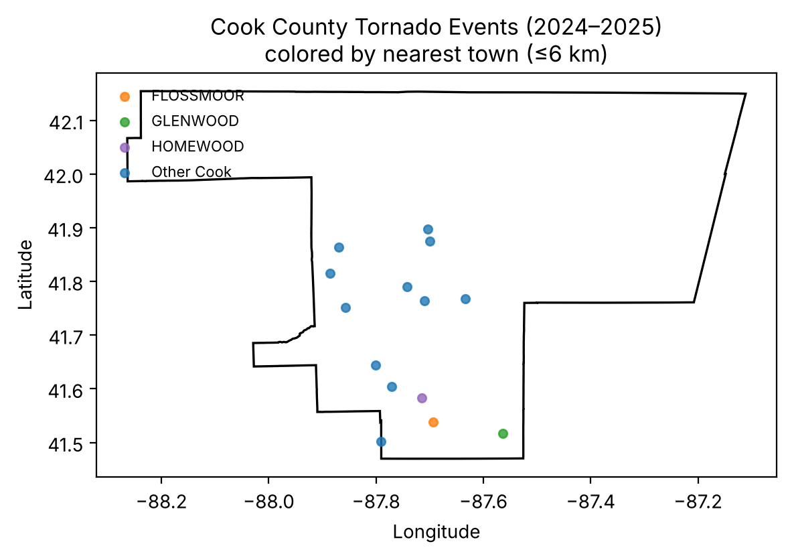

# Tornado Activity in Cook County's South Suburbs

A geospatial analysis in Python of where recent tornadoes in Cook County, Illinois occurred, and whether they clustered near four south suburban communities: Flossmoor, Homewood, Glenwood, and Chicago Heights.

**[View the full notebook →](tornado_analysis.ipynb)**



## Question

What share of Cook County's recent tornadoes occurred near the south suburban corridor? Storms in the region often track southwest to northeast across the south suburbs, so the hypothesis was a modest concentration there relative to the rest of the county.

## Data

- **NOAA/NCEI Storm Events database:** severe weather reports for Cook County, May 2024 – May 2025 (229 events, 15 tornadoes)
- **U.S. Census TIGER/Line 2025 counties:** Cook County boundary (extracted from the national county shapefile)

## Approach

1. **Cleaned and filtered** the storm reports to tornadoes with valid coordinates.
2. **Spatial filter:** point-in-polygon test (Shapely) to keep only tornadoes that started inside the Cook County boundary.
3. **Proximity assignment:** haversine distance from each tornado to each study town. Tornadoes within 6 km were assigned to the nearest town; the rest were labeled "Other Cook."
4. **Summarized and mapped** the counts and each area's share of the county total.

## Results

| Area | Tornadoes | Share of Cook County |
|---|---|---|
| Other Cook | 11 | 78.6% |
| Flossmoor | 1 | 7.1% |
| Homewood | 1 | 7.1% |
| Glenwood | 1 | 7.1% |
| Chicago Heights | 0 | 0% |

3 of the 14 Cook County tornadoes (about 21%) started within 6 km of one of the four study towns.

**Limitations:** one year of data and 14 events is too small to establish a real geographic pattern, and results depend on the 6 km threshold. A multi-decade record and a comparison against each area's share of county land area would be needed to properly test the hypothesis.

## Tools

Python · pandas · Fiona · Shapely · Matplotlib

## Files

| File | Description |
|---|---|
| `tornado_analysis.ipynb` | Full analysis with code, output, and maps |
| `data/storm_data_search_results.csv` | NOAA Storm Events export for Cook County |
| `data/cook_county.*` | Cook County boundary shapefile |
| `outputs/` | Generated counts table, tornado points, and charts |

## Run it yourself

```bash
pip install pandas geopandas fiona shapely matplotlib jupyter
jupyter notebook tornado_analysis.ipynb
```

*Originally completed as a course project for GGIS 407 at the University of Illinois Urbana-Champaign.*
